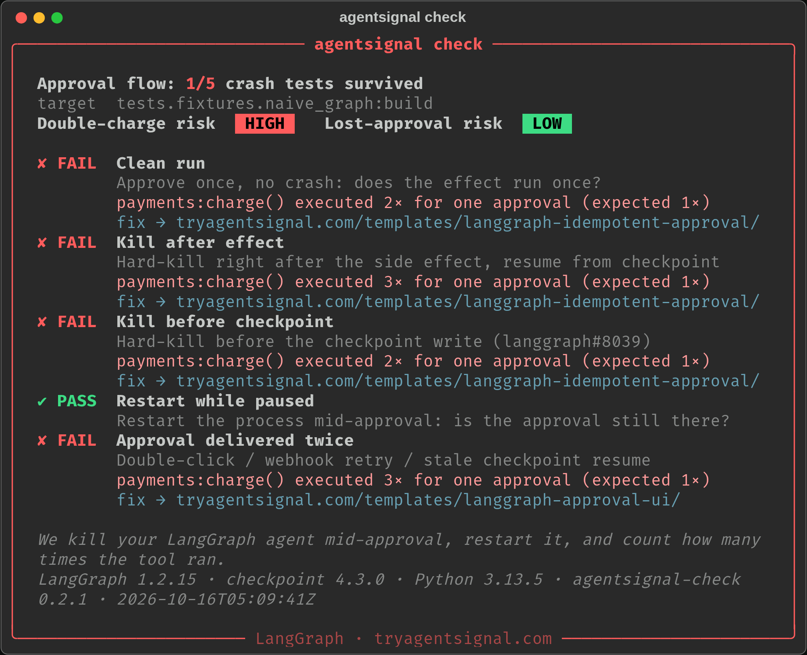

# agentsignal check



*We kill your LangGraph agent mid-approval, restart it, and count how many times the tool ran.* (A real run against the intentionally broken example graph.)

Crash-test your AI agent for **double execution** and **lost approvals** before your users find them.
It runs on your machine or in CI. It's free and MIT-licensed. Built by [Agent Signal](https://tryagentsignal.com).

```bash
pip install "agentsignal-check[langgraph] @ git+https://github.com/MounirMeziani/agentsignal-check"

agentsignal check --graph myapp.graph:build --effect myapp.payments:charge \
  --input '{"amount":1999}' --report agentsignal-report.md
```

- `--graph mod:factory`: `factory(checkpointer)` returns your compiled LangGraph graph. The harness injects a SQLite checkpointer so state survives process death.
- `--effect mod:func` (can be repeated): the side effects that must happen at most once, such as a charge, an email or a delete.
- `--resume JSON`: the value sent to every `interrupt()`. Default `true` (approve).
- `--report FILE`: writes a markdown report with fixes. `--json` prints machine-readable output.
- Exit code 1 on any FAIL, so you can use it as a CI gate.

## Report card, HTML, OG image, badge
```bash
agentsignal check --graph myapp.graph:build --effect myapp.payments:charge \
  --html report.html --png og.png --badge agentsignal-badge.svg --badge-link https://example.com/report.html
```
- **Terminal:** an 80-column report card with the grade ("Approval flow: 3/5 crash tests survived"), double-charge and lost-approval risk, and one row per detector with why and how to fix. With `NO_COLOR` set or output piped, it prints plain text. `--json` output is unchanged.
- `--html`: a self-contained dark report page with OG/Twitter meta, and `--svg` exports the terminal card.
- `--png`: a 1200×630 OG card. It needs `pip install "agentsignal-check[png]"` (Pillow).
- `--badge`: a static SVG plus a README snippet. The badge reads **Crash-tested by Agent Signal | N/M** (amber) by default. It switches to **Agent Signal crash test | passing** (green) only when all 5 detectors passed on that run. For example:
  ```bash
  agentsignal check --graph myapp.graph:build --effect myapp.payments:charge \
    --badge docs/agentsignal-badge.svg --badge-link https://example.com/report.html
  # prints e.g.: [](https://example.com/report.html)
  ```
  Commit the SVG, paste the snippet into your README, and link it to that repo's latest report. Re-run in CI so it reflects the current commit.

The grade, risks and badge are computed only from the detector results of the current run. The screenshot at the top is a real run against `tests/fixtures/naive_graph.py`, the intentionally broken example. Regenerate it with `scripts/shots.sh`.

## Detectors (LangGraph)
| id | fault injected | FAIL means |
|---|---|---|
| `baseline` | none (clean run, auto-approve) | an effect ran twice with no crash (side effect before `interrupt()` in the same node) |
| `double_execution.kill_resume` | hard kill (`os._exit`) right after each effect, then resume in a fresh process | the effect was re-executed |
| `double_execution.kill_before_checkpoint` | hard kill before each checkpoint `put()`, after `put_writes` ([langgraph#8039](https://github.com/langchain-ai/langgraph/issues/8039)) | the effect was re-executed on recovery |
| `approval.lost_on_restart` | restart the process while paused | the pending approval is gone |
| `approval.replay` | deliver the same approval twice, including against a stale checkpoint | the effect ran again |

A duplicate means the same effect args returned **different** results. A retry that returns the same result (for example, a provider idempotency key) passes.

## Detectors (OpenAI Agents SDK, preview on branch oai-runstate)

```bash
pip install "agentsignal-check[openai-agents] @ git+https://github.com/MounirMeziani/agentsignal-check@oai-runstate"
agentsignal check --framework openai-agents --agent myapp.agent:build \
  --effect myapp.payments:charge --context '{"order_id": "order-42"}'
```

`build()` returns an `agents.Agent` whose side-effect tools use `needs_approval=True`. State crosses process
boundaries only as `RunState.to_json()` / `RunState.from_json()`, as a real app would persist a paused run.

| Detector | What it does |
|---|---|
| baseline | Clean run, approve once: does the effect run once? |
| double_execution.kill_resume | Approve + resume, hard-kill (`os._exit(137)`) right after the effect, restart from the persisted RunState, approve again |
| approval.lost_on_restart | Is the pending approval visible from a fresh process, and is an approval persisted via `to_json()` honoured without re-asking? |
| approval.replay | The same persisted RunState resumed twice (double-click, worker retry, queue redelivery) |

Real run, openai-agents 0.24.0, offline scripted model (`tests/fixtures/oai_*.py`): naive agent
baseline PASS, kill_resume FAIL, lost_on_restart PASS, replay FAIL; idempotent agent (key = order_id + tool name) 4/4 PASS.

## Test scratch space
Each scenario sets `AS_SCENARIO` to a unique path. If your effect writes to a local store during the check, key the store on it so scenarios don't leak into each other.

## Upload runs (Signal Pro)

```bash
export AGENTSIGNAL_API_KEY=...   # create one at https://tryagentsignal.com/pro/keys
agentsignal check --graph app:build --effect app.tools:charge --json --upload
```

Prints the `run_id` and fix links for every FAIL. Upload errors (bad key, too large, rate limit, network) are reported but don't change the exit code unless you pass `--upload-strict` (exit 3). Without a key, `--upload` only prints a one-line hint.

## Fixing failures
Every FAIL in the report links to a free tested pattern on [tryagentsignal.com](https://tryagentsignal.com). Want it done for you? Use the [$79 Fix](https://tryagentsignal.com/fix).

## Develop / test
```bash
uv run --extra test pytest -q          # or: pip install -e ".[test]" && pytest -q
```
`test` installs pytest and the `langgraph` extra. If you run without it, the LangGraph tests are skipped with a note rather than failing with a cryptic error.
MIT © Mounir Meziani
